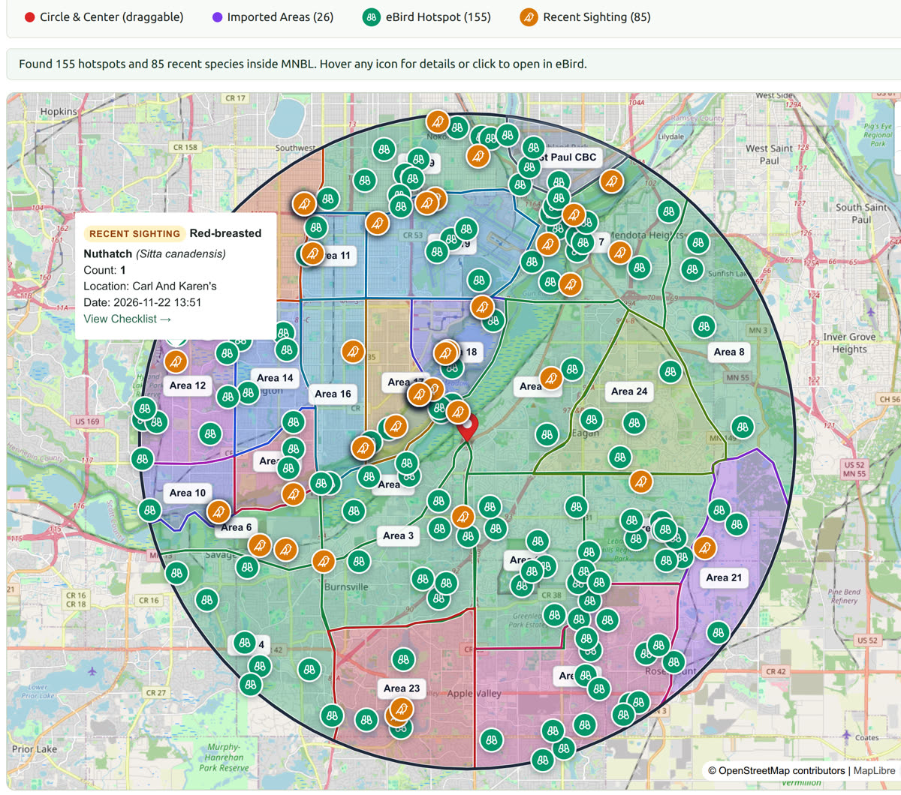

# CBC Circle Manager

CBC Circle Manager is a browser-only tool for Christmas Bird Count (CBC) compilers. It tracks volunteers, area assignments, and results for one or more count circles.

I've been the compiler for the Bloomington, MN count since 2020, and I wrote this app to run it. You can find our count on [Audubon's circle page](https://cbc.audubon.org/en/join/circles/MNBL) and on [our own website](https://www.bloomingtoncbc.org/).

The roster lives in a PostgreSQL database that runs inside your browser ([PGlite](https://pglite.dev)) and is saved to IndexedDB. There's no server. Your roster never leaves your browser unless you export it.

## What it looks like

This is the Bloomington, MN circle. I drew the 26 count areas in Google My Maps and imported them as a KML file. The hotspots and recent sightings came from eBird with my own API key.

The top of the page shows the circle's count date and compiler, how many areas are counted, how many people are counting, which areas still need a field counter, and, from count day on, which areas haven't sent in results. **Feedback** and **Share** are in the top right:


Hover over an area to see how many people are assigned to it, and click it to open that area:


Hover over a hotspot to see its all-time species count and latest checklist date:


Hover over a recent sighting to see the species, count, place, and date, with a link to the checklist:



## Before you start

- **It's bring your own key (BYOK).** The map's eBird hotspots and recent sightings need your own eBird API key. Everything else works without one, including scouting a new location. See [Set up your eBird key](#set-up-your-ebird-key).
- **It doesn't draw areas.** The app shows the 15-mile circle, but it can't draw your count areas (sectors) on it. If you want area outlines on the map, make them somewhere else and import them as a KML, KMZ, or GeoJSON file. As far as I know, the Audubon site doesn't export area boundaries. Google My Maps does: draw each area as a shape, name it with its area code (for example `12 - Richfield`), and export the map to KML.

## Features

- **My Circles:** keep several circles, each with its own areas, count years, roster, notes, and map boundaries. Add a circle by Audubon code or place search, by importing a KML, KMZ, or GeoJSON file, or by entering coordinates.
- **Audubon circle details:** adding an Audubon circle, or clicking **Refresh from Audubon**, pulls the count date, the publicly listed compiler, and the circle center from `https://cbc.audubon.org/en/join/circles/<CODE>`.
- **Roster and assignments:** reassign counters between areas, see open areas (areas with no confirmed field counter), and track which areas have sent in results.
- **Reminders and outreach:** a list of people on your current list who haven't answered yet this season, with a Copy BCC button. Until you mark a current list, it shows every active person who hasn't answered. Possible Outreach lists people on the Audubon list who aren't on your current list, and people on your current list who also have another email that may be old. Tick **This file is my current list** when you import your mailing list. Outreach shows only active and inactive people.
- **Map:** a draggable 15-mile-diameter circle on an OpenFreeMap street map built from OpenStreetMap data. There is no satellite view, because Esri's World Imagery terms require Esri software or an ArcGIS subscription. Imported area outlines highlight when you hover over them, and clicking one opens that area.
- **Share an area:** on an area's page, **Share Area** makes a link and a QR code that open the area in Circle Scout. They carry the circle, the area outline, and the name, phone, and email of the area's leaders, and nothing else about people. The data sits after the `#` in the link, so it never reaches a server. See [Circle Scout](#circle-scout).
- **eBird scouting:** hotspots and recent sightings inside the circle, using your eBird API key. Each hotspot and sighting is listed with the count area it falls in. The web app saves results in your browser and fetches them from eBird at most once a day for the same circle and day range. Circle Scout checks for new sightings more often. See [Settings](#settings).
- **Circle Scout:** a phone app for your field counters. It shows a counter their area, where they are, and what's been seen nearby, and records the party's hours and miles. See [Circle Scout](#circle-scout).
- **Import and export:** import a participant spreadsheet (`.xlsx` or `.csv`) and match its columns, or import the participant list you export from your Audubon circle page, which needs no setup. You can also export the roster to Excel or CSV, and export or restore a full JSON backup.

## Set up your eBird key

In the web app, you set the key once, on the **Help & API Keys** tab. It isn't on the map page, and it isn't per circle: one key works for every circle and for scouting. Circle Scout asks for the key on its own screen. See [Add an eBird key](#add-an-ebird-key).

1. Sign in to eBird and request a free key at [ebird.org/api/keygen](https://ebird.org/api/keygen). For the intended use, something like "Christmas Bird Count circle scouting" is fine. The key shows up right away.
2. In the app, open the **Help & API Keys** tab.
3. Paste the key into the box under the steps and click **Save Key**.
4. Go to **Map & eBird Scout**, pick how many days back you want, and click **Load Hotspots & Sightings**.

Until a key is saved, **Load Hotspots & Sightings** and the days dropdown are grayed out. Hover over them and they tell you where to add the key. The key is saved only in this browser's `localStorage` and is sent only to eBird. To forget it, click **Remove Key** on the same tab. The hosted copy and a copy you run yourself each need the key saved once, because each address has its own browser storage.

The web app saves each eBird result in this browser for the rest of the day. Asking again for the same circle center and day range shows the saved copy instead of calling eBird. A new day, a moved pin, or a different day range fetches fresh data.

## Circle Scout

Circle Scout is a phone app for your field counters. It's at https://lizstanley.com/cbc-circle-manager/circle-scout/. It shows a counter their area on a map, where they are, and what's been seen nearby, and it records the party's hours and miles. There's no account to make.

### Install it

Open the address on the phone.

- **iPhone and iPad:** in Safari, tap **Share**, then **Add to Home Screen**. Circle Scout shows these steps at the top of the page.
- **Android:** in Chrome, tap **Install** on the bar at the top of Circle Scout. The bar shows once Chrome offers to install it.

It also works in a plain browser tab. On iPhone, the home screen app keeps its own storage, apart from Safari. If an area link opens in a Safari tab, Circle Scout says so. Open the installed app and paste the same link with **Paste link**.

### Add an eBird key

Circle Scout needs an eBird API key before it shows anything, so its first screen asks for one. Get a key as in [Set up your eBird key](#set-up-your-ebird-key), paste it, and tap **Save key**. The screen links to the eBird request page too.

To change the key later, open the menu at the top and tap **eBird key**. If eBird rejects the key, the lists show a **Fix eBird key** button that opens the same screen.

The web app and Circle Scout share one saved key, but only in the same browser on the same device. A counter's phone needs the key entered once.

### Send counters their area

In the web app, open an area and click **Share Area**. It makes a link and a QR code. Send the link with **Share Link** or **Copy Link**, or print the QR code or show it on screen for counters in person.

The counter loads the area in Circle Scout one of three ways:

- Open the link. Circle Scout opens with the area.
- On the **Your area** tab, tap **Paste link**, paste the link, and tap **Load**. **Paste from clipboard** does both in one tap, where the phone allows it.
- On the **Your area** tab, tap **Scan area code** and point the camera at the QR code.

Circle Scout keeps every area it loads, with one active at a time. With more than one, pick the active area from the list on **Your area**. **Remove area** takes the active area off the phone.

### What it shows

- **Map:** the 15-mile circle and the area's outline. Tap the location button on the map to show where you are. While it's on, the line above the map says whether you're in your area, outside your area, or outside the circle. If you leave it on, it's on again the next time you open Circle Scout.
- **Nearby:** notable sightings, then recent sightings, then eBird hotspots. The lists show once location is on. Each list puts places in your area first, then the rest, nearest first. Pick how many days back, from 1 to 30. With an area loaded, the lists cover the whole circle. With none, they cover 7.5 miles around you. Each sighting links to its eBird checklist.
- **Suggestions:** **Hotspots to visit**, the hotspots in your area (or every hotspot, with no area loaded) ranked by the species last reported there. With an area loaded whose outline is a shape, not a route line, it also shows **Birds to look for**, species whose latest report is outside your area.
- **Directions:** every place shows its distance from you, its direction once it's more than a tenth of a mile away, and a **Directions** link. It opens Apple Maps on iPhone and iPad, and Google Maps everywhere else.
- **Your area:** the area's name and its leaders, with their phone and email as tap-to-call and tap-to-email links.
- **Start count:** a counter taps **Start count** in Circle Scout, and while it stays open on screen it keeps the screen on, draws the route, and sorts each stretch by speed into travel by vehicle or by foot. The counter can change any stretch's mode, and enters the number of participants in the party and any feeder watching hours. Time in other apps counts toward hours. A break in recording, such as switching apps, shows as a dashed straight line whose distance counts toward the miles. After **Stop count**, **Share totals** sends the party's line of the count sheet as text: area number, participants, one party, hours by vehicle, by foot, and feeder watching, and miles by vehicle and by foot. The compiler adds up the parties for each area. Recording pauses while location is off. The route stays on the phone.

### Settings

Open the menu and tap **Settings**. **Check eBird for new sightings** sets how often the Nearby and Suggestions lists check eBird: every 15 minutes, every half hour, every hour, or every 2 hours. The default is every half hour. Checking less often uses less data and battery. Hotspots change rarely, so they don't follow this setting. Circle Scout uses the copy it saved that day, and fetches them again only for a new search place or key, or after a failed fetch.

### It needs a signal

Circle Scout needs a signal to open, to draw the map, and to check eBird. It doesn't save itself for offline use. If the signal drops, the lists keep what they last loaded.

### What stays on the phone

Circle Scout has no database and no server. It keeps these in the phone's browser storage:

- the eBird key
- the saved areas
- the Settings choice
- whether location tracking is on
- the count session and its route
- copies of the day's eBird results

It sends:

- the key, the place to search, and the days back to eBird. The place is the circle's center when an area is loaded, or your location when none is.
- map views to OpenFreeMap, for the map tiles.

Nothing goes to any other server. The area data sits after the `#` in the link, so it never reaches a server, and Circle Scout removes it from the address bar once it's read. **Directions** and checklist links open Apple Maps, Google Maps, or eBird only when tapped. **Share totals** goes wherever the counter sends it.

## Import your roster

You import people on the **Import / Export Participants** tab.

1. Pick the circle in **My Circles**. The import always goes into the circle that's selected.
2. Under **Import Participant Roster**, choose a `.csv`, `.xlsx`, or `.xls` file. Only the first sheet is read.
3. Match the columns. The app guesses each one from the header names, and you can change any guess.
   - **Email** is the only required column. Rows without a valid email are skipped. If the same email shows up again, the later row updates the same person.
   - **Name**, **Area**, **RSVP**, **Counter Type**, and **Notes** are optional.
4. Check the value tables. For RSVP and counter type, the app lists each value it found in your file, like "Yes" or "Maybe", and what it'll be saved as. You can change any of them.
5. If your file has no RSVP column, choose the RSVP for people who are new this season. People already on this season's list keep theirs.
6. If the file is your mailing list, tick **This file is my current list**. Possible Outreach compares the Audubon list against it.
7. Read the preview. It shows the first 10 rows, and it warns you about rows that'll be skipped, emails that appear more than once, and area codes the circle doesn't have yet.
8. Click **Import**.

A column you skip, or a blank Area, keeps what's already saved for this season.

If you import the participant list you export from your Audubon circle page, the app recognizes it and skips the column matching. It adds new people and marks who's on the Audubon list. It never changes the RSVP, counter type, or area you already have for someone.

Not sure how to lay out your file? Under **What columns can I use?** there's a sample `.csv` and `.xlsx` with made-up people you can start from.

## Use it online

The app is hosted at https://lizstanley.com/cbc-circle-manager/. Your data stays in your browser. It isn't sent to GitHub or any server. Each address has its own browser database, so the hosted copy and a copy you run yourself don't share data. Use **Export Backup** to move data between them.

**Refresh from Audubon** works only when you run the app on your own computer, because the Audubon site blocks requests from other sites. Everything else works in the hosted copy.

Every push to `main` runs the tests and redeploys through `.github/workflows/pages.yml`.

## Run it

```bash
npm install
npm run dev
```

Open `http://localhost:5173`. A new browser database starts empty.

To build a static site:

```bash
npm run build
```

You can deploy `dist/` to any static host. Each visitor gets their own private database in their own browser.

The Audubon circle page sends no CORS headers (the browser refuses to read it from another site), so the app reaches it through the `/audubon-cbc` proxy in `vite.config.ts`. That proxy runs only under `npm run dev` and `npm run preview`. On a static host, Audubon circle details aren't available, and circle search uses Audubon's ArcGIS layer instead.

Each address (`localhost:5173` for dev, `localhost:4173` for preview) has its own browser database.

Run the tests with `npm test`. They include integration tests that run the real schema, migrations, import, and backup code in an in-memory PGlite. `npm run lint` and `npm run typecheck` run in CI on every pull request.

Why the app is built this way: [DESIGN.md](DESIGN.md).

## Back up your data

Browser storage can be cleared, and it doesn't move between computers. Use **Export Backup** after each import or big change. **Restore Backup** replaces the roster of every circle in the backup file, after you confirm.

The app asks the browser for persistent storage, so your data isn't evicted when disk space runs low. That doesn't protect you from clearing site data yourself.

In Chrome and Edge, **Auto-Save** keeps a backup file up to date on disk. Click it once and pick a file. The app rewrites that file after every change. After a browser restart, the button shows **Reconnect**. Click it once to allow writing again. To restore from that file, use **Restore Backup**.

## Questions and ideas

If something's confusing, broken, or missing, or you have an idea that would help your count, tell me on [GitHub Discussions](https://github.com/lizmstanley/cbc-circle-manager/discussions). It's public, so please don't post volunteer names, emails, or backup files.

## License

The app is licensed under the [PolyForm Noncommercial License 1.0.0](LICENSE.md). You can use, change, and share it for any noncommercial purpose. Anyone you share it with must also get the license terms and the `Required Notice:` line from [LICENSE.md](LICENSE.md).

Bird data comes from [eBird.org](https://ebird.org) and is subject to the [eBird API Terms of Use](https://www.birds.cornell.edu/home/ebird-api-terms-of-use/). The app credits eBird.org, with a link, wherever it shows that data.

## Project structure

```text
cbc-circle-manager/
├── circle-scout/                    # Circle Scout: its page (index.html) and its code (src/)
├── db/
│   ├── migrations/                  # Versioned, applied once each, recorded in schema_version
│   │   ├── 001_initial_schema.sql   # Tables, enums, and indexes, all scoped by circle_code
│   │   ├── 002_catch_up_unversioned_databases.sql
│   │   └── 003_area_results_by_season.sql
│   └── views.sql                    # Assignments, open areas, reminders, outreach (re-applied on every start)
├── src/
│   ├── db/
│   │   ├── migrations.ts            # Migration runner and file parsing
│   │   ├── cbcDb.ts                 # Database class the app uses
│   │   ├── circles.ts, areas.ts, roster.ts, seasons.ts, readModels.ts, backup.ts   # Queries by concern
│   │   ├── legacySingleCircle.ts    # One-time move from the first single-circle format
│   │   ├── pgliteDb.ts              # Browser setup: IndexedDB storage and bundled migrations
│   │   └── *.integration.test.ts    # Real PGlite, in memory
│   ├── services/                    # eBird, Audubon, KML parsing, import checks
│   ├── hooks/                       # App state and actions
│   ├── components/                  # Tabs, dialogs, the map (components/map/), and roster import (components/import/)
│   ├── App.tsx
│   └── main.tsx
├── DESIGN.md
├── LICENSE.md
├── index.html
├── package.json
├── tsconfig.json
└── vite.config.ts
```
