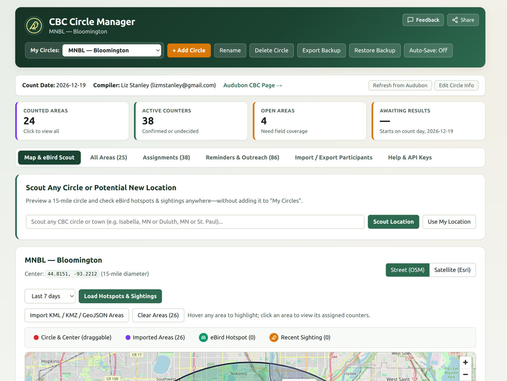
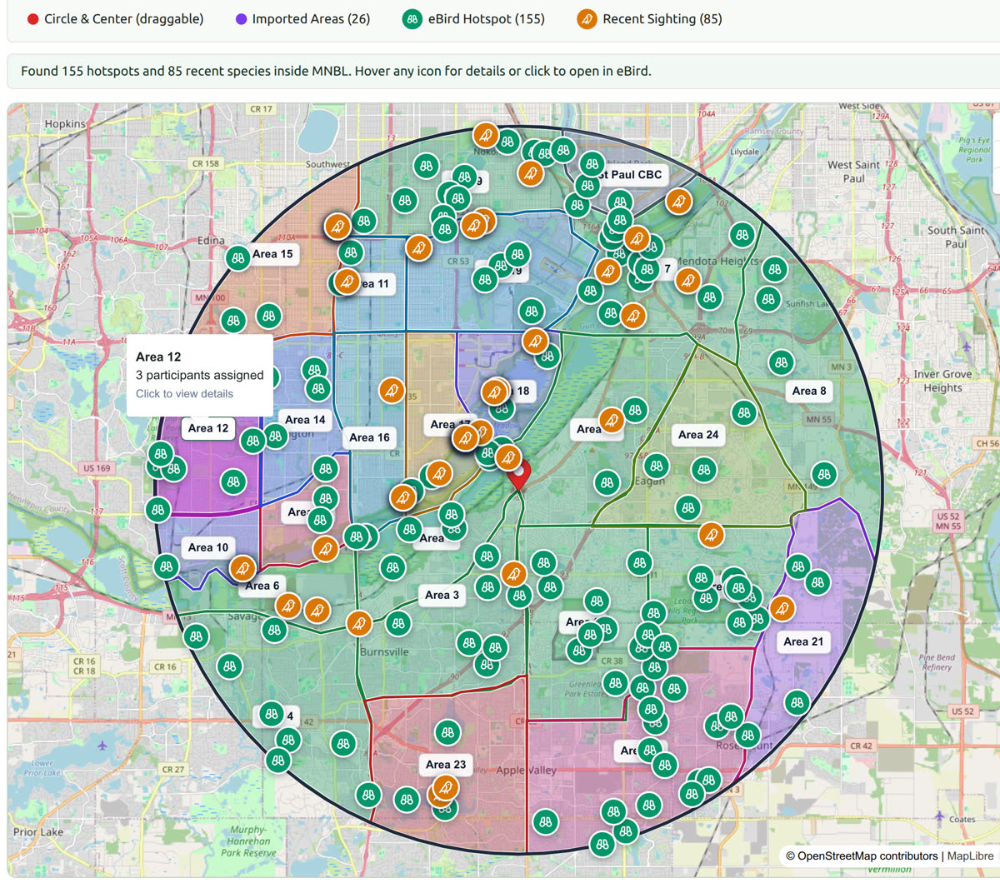
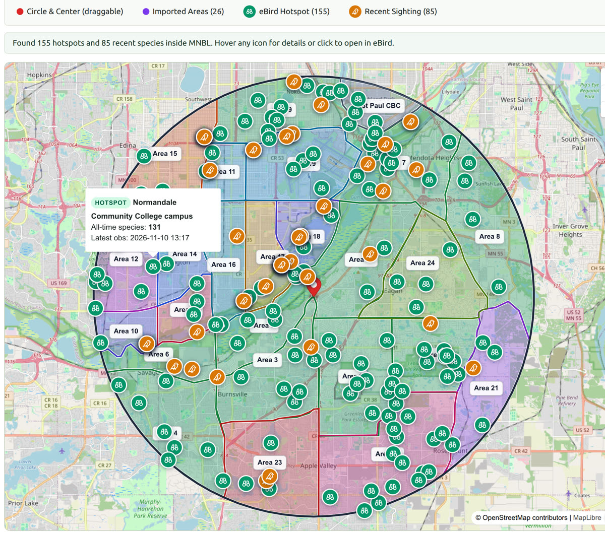

# CBC Circle Manager

CBC Circle Manager is a browser-only tool for Christmas Bird Count (CBC) compilers. It tracks volunteers, area assignments, and results for one or more count circles.

I've been the compiler for the Bloomington, MN count since 2020, and I wrote this app to run it. You can find our count on [Audubon's circle page](https://cbc.audubon.org/en/join/circles/MNBL) and on [our own website](https://www.bloomingtoncbc.org/).

The roster lives in a PostgreSQL database that runs inside your browser ([PGlite](https://pglite.dev)) and is saved to IndexedDB. There's no server. Your roster never leaves your browser unless you export it.

## What it looks like

This is the Bloomington, MN circle. I drew the 26 count areas in Google My Maps and imported them as a KML file. The hotspots and recent sightings came from eBird with my own API key.

The top of the page shows the circle's count date and compiler, how many areas are counted, how many people are counting, which areas still need a field counter, and, from count day on, which areas haven't sent in results. **Feedback** and **Share** are in the top right:



Hover over an area to see how many people are assigned to it, and click it to open that area:



Hover over a hotspot to see its all-time species count and latest checklist date:



Hover over a recent sighting to see the species, count, place, and date, with a link to the checklist:


## Before you start

- **It's bring your own key (BYOK).** The map's eBird hotspots and recent sightings need your own eBird API key. Everything else works without one, including scouting a new location. See [Set up your eBird key](#set-up-your-ebird-key).
- **It doesn't draw areas.** The app shows the 15-mile circle, but it can't draw your count areas (sectors) on it. If you want area outlines on the map, make them somewhere else and import them as a KML, KMZ, or GeoJSON file. As far as I know, the Audubon site doesn't export area boundaries. Google My Maps does: draw each area as a shape, name it with its area code (for example `12 - Richfield`), and export the map to KML.

## Features

- **My Circles:** keep several circles, each with its own areas, count years, roster, notes, and map boundaries. Add a circle by Audubon code or place search, by importing a KML, KMZ, or GeoJSON file, or by entering coordinates.
- **Audubon circle details:** adding an Audubon circle, or clicking **Refresh from Audubon**, pulls the count date, the publicly listed compiler, and the circle center from `https://cbc.audubon.org/en/join/circles/<CODE>`.
- **Roster and assignments:** reassign counters between areas, see open areas (areas with no confirmed field counter), and track which areas have sent in results.
- **Reminders and outreach:** a list of people on your current list who haven't answered yet this season, with a Copy BCC button. Until you mark a current list, it shows every active person who hasn't answered. Possible Outreach lists people on the Audubon list who aren't on your current list, and people on your current list who also have another email that may be old. Tick **This file is my current list** when you import your mailing list. Outreach shows only active and inactive people.
- **Map:** a draggable 15-mile-diameter circle with OpenStreetMap street tiles or Esri satellite tiles. Imported area outlines highlight when you hover over them, and clicking one opens that area.
- **eBird scouting:** hotspots and recent sightings inside the circle, using your eBird API key. Each hotspot and sighting is listed with the count area it falls in.
- **Import and export:** import a participant spreadsheet (`.xlsx` or `.csv`) and match its columns, or import the participant list you export from your Audubon circle page, which needs no setup. You can also export the roster to Excel or CSV, and export or restore a full JSON backup.

## Set up your eBird key

You set the key once, on the **Help & API Keys** tab. It isn't on the map page, and it isn't per circle: one key works for every circle and for scouting.

1. Sign in to eBird and request a free key at [ebird.org/api/keygen](https://ebird.org/api/keygen). For the intended use, something like "Christmas Bird Count circle scouting" is fine. The key shows up right away.
2. In the app, open the **Help & API Keys** tab.
3. Paste the key into the box under the steps and click **Save Key**.
4. Go to **Map & eBird Scout**, pick how many days back you want, and click **Load Hotspots & Sightings**.

Until a key is saved, **Load Hotspots & Sightings** and the days dropdown are grayed out. Hover over them and they tell you where to add the key. The key is saved only in this browser's `localStorage` and is sent only to eBird. To forget it, click **Remove Key** on the same tab. The hosted copy and a copy you run yourself each need the key saved once, because each address has its own browser storage.

## Import your roster

You import people on the **Import / Export Participants** tab.

1. Pick the circle in **My Circles**. The import always goes into the circle that's selected.
2. Under **Import Participant Roster**, choose a `.csv`, `.xlsx`, or `.xls` file. Only the first sheet is read.
3. Match the columns. The app guesses each one from the header names, and you can change any guess.
   - **Email** is the only required column. Rows without a valid email are skipped. If the same email shows up again, the later row updates the same person.
   - **Name**, **Area**, **RSVP**, **Counter Type**, and **Notes** are optional.
4. Check the value tables. For RSVP and counter type, the app lists each value it found in your file, like "Yes" or "Maybe", and what it'll be saved as. You can change any of them.
5. If your file has no RSVP column, choose the RSVP for people who are new this season. People already on this season's list keep theirs.
6. If the file is your mailing list, tick **This file is my current list**. Possible Outreach compares the Audubon list against it.
7. Read the preview. It shows the first 10 rows, and it warns you about rows that'll be skipped, emails that appear more than once, and area codes the circle doesn't have yet.
8. Click **Import**.

A column you skip, or a blank Area, keeps what's already saved for this season.

If you import the participant list you export from your Audubon circle page, the app recognizes it and skips the column matching. It adds new people and marks who's on the Audubon list. It never changes the RSVP, counter type, or area you already have for someone.

Not sure how to lay out your file? Under **What columns can I use?** there's a sample `.csv` and `.xlsx` with made-up people you can start from.

## Use it online

The app is hosted at https://lizmstanley.github.io/cbc-circle-manager/. Your data stays in your browser. It isn't sent to GitHub or any server. Each address has its own browser database, so the hosted copy and a copy you run yourself don't share data. Use **Export Backup** to move data between them.

**Refresh from Audubon** works only when you run the app on your own computer, because the Audubon site blocks requests from other sites. Everything else works in the hosted copy.

Every push to `main` runs the tests and redeploys through `.github/workflows/pages.yml`.

## Run it

```bash
npm install
npm run dev
```

Open `http://localhost:5173`. A new browser database starts empty.

To build a static site:

```bash
npm run build
```

You can deploy `dist/` to any static host. Each visitor gets their own private database in their own browser.

The Audubon circle page sends no CORS headers (the browser refuses to read it from another site), so the app reaches it through the `/audubon-cbc` proxy in `vite.config.ts`. That proxy runs only under `npm run dev` and `npm run preview`. On a static host, Audubon circle details aren't available, and circle search uses Audubon's ArcGIS layer instead.

Each address (`localhost:5173` for dev, `localhost:4173` for preview) has its own browser database.

Run the unit tests with `npm test`.

## Back up your data

Browser storage can be cleared, and it doesn't move between computers. Use **Export Backup** after each import or big change. **Restore Backup** replaces the roster of every circle in the backup file, after you confirm.

The app asks the browser for persistent storage, so your data isn't evicted when disk space runs low. That doesn't protect you from clearing site data yourself.

In Chrome and Edge, **Auto-Save** keeps a backup file up to date on disk. Click it once and pick a file. The app rewrites that file after every change. After a browser restart, the button shows **Reconnect**. Click it once to allow writing again. To restore from that file, use **Restore Backup**.

## Questions and ideas

If something's confusing, broken, or missing, or you have an idea that would help your count, tell me on [GitHub Discussions](https://github.com/lizmstanley/cbc-circle-manager/discussions). It's public, so please don't post volunteer names, emails, or backup files.

## Project structure

```text
cbc-circle-manager/
├── db/
│   └── migrations/
│       ├── 001_initial_schema.sql   # Tables, enums, and indexes, all scoped by circle_code
│       └── 002_views.sql            # Assignments, open areas, reminders, outreach
├── src/
│   ├── db/pgliteDb.ts               # Browser database: setup, upgrades, queries, backup and restore
│   ├── services/
│   │   ├── ebird.ts                 # eBird API v2 client
│   │   ├── audubonCircles.ts        # Circle search (ArcGIS, then OpenStreetMap Nominatim)
│   │   ├── audubonCirclePage.ts     # Count date and compiler from the Audubon circle page
│   │   └── kmlParser.ts             # KML, KMZ, and GeoJSON boundary parser
│   ├── components/                  # Map, area detail, results, importer, dialogs, help
│   ├── App.tsx
│   └── main.tsx
├── index.html
├── package.json
├── tsconfig.json
└── vite.config.ts
```
